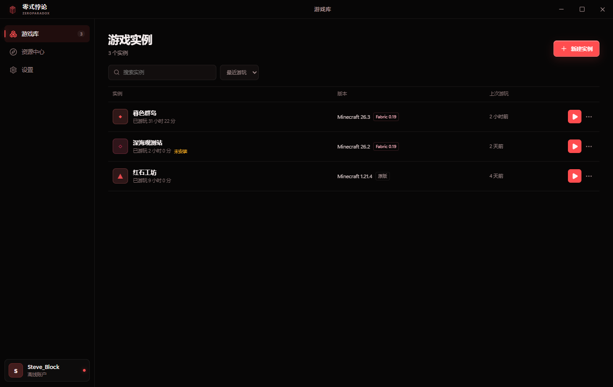

# 零式悖论 / ZeroParadox

一个用 Electron、React 和 TypeScript 编写的 Minecraft 启动器。红黑纯色界面，
支持原版 / Fabric 实例、自动安装游戏文件、自动选择 Java，以及从 Modrinth
安装模组、资源包和光影。

> 功能方向参考了 [PrismLauncher](https://github.com/PrismLauncher/PrismLauncher)。
> 本项目是独立实现，不包含 PrismLauncher 的代码或美术资源。



## 功能

- **实例隔离**：每个实例使用独立的 `minecraft` 目录，模组、存档和设置互不影响。
- **原版 / Fabric / Forge**：支持原版、Fabric 和 Forge；Forge 可在创建实例时选择推荐版或最新版。
- **自动安装**：从 Mojang 或 BMCLAPI 下载客户端、依赖库、资源和日志配置，
  使用 SHA-1 校验文件。
- **Java 检测**：优先使用本机合适的 Java；没有时下载 Mojang Java Runtime。
- **Modrinth**：按实例的游戏版本和加载器筛选内容，安装必需依赖。
- **账户**：离线账户，以及 Microsoft 正版登录（设备码流程）。
- **日志**：启动过程和游戏输出可在实例详情中查看。
- **本地数据**：设置、账户、游戏文件都保存在本机。

## 当前范围

- 加载器：**Vanilla**、**Fabric**、**Forge**、**NeoForge**。
- 账户：离线账户、Microsoft 正版账户。微软登录使用本项目已通过 Mojang 审批的 appID，
  开箱即用。
- 整合包：支持 Modrinth `.mrpack` 与 CurseForge / Prism / 普通 zip 导入。
- 现有实例：可直接把其他启动器的实例目录挂进游戏库，支持批量扫描。
- 目前提供 Windows x64 构建。其他平台未测试。

## 微软正版登录

在账户窗口点击 **Microsoft 正版登录**，直接点“开始登录”即可完成设备码登录，
不需要填写任何东西。

启动器内置的 Azure 应用（Client ID 见 `src/shared/azure.ts`）已于 2026-10-21
通过 Mojang 的 appID 审批，被加入 Minecraft 服务的允许名单。

> 授权码、访问令牌和刷新令牌保存在本机的 `launcher.json` 中；启动器不会
> 向第三方服务器发送这些令牌。

## 运行

需要 Node.js 22+ 和 pnpm。

```bash
pnpm install
pnpm dev
```

首次使用：点击左下角账户卡片添加离线用户名 → 新建实例 → 点击播放按钮。
首次启动会下载约 500 MB 文件，后续启动只做校验。

如果 Electron 下载缓慢，可以先设置镜像：

```powershell
$env:ELECTRON_MIRROR = "https://npmmirror.com/mirrors/electron/"
pnpm install
```

## 构建

```bash
pnpm typecheck
pnpm build
pnpm dist
```

`pnpm dist` 生成：

```text
release/ZeroParadox-1.0.0-x64.exe        NSIS 安装程序
release/ZeroParadox-1.0.0-portable.exe   便携版
```

安装包未做代码签名，Windows SmartScreen 可能提示“未知发布者”或
“打开文件 - 安全警告”。选择“更多信息 → 仍要运行”即可。

便携版将数据保存在程序旁的 `ZeroParadoxData/`；安装版使用
`%APPDATA%\ZeroParadox\data`。

## 启动问题

安装后请使用桌面或开始菜单里的 **零式悖论** 快捷方式。

- `ZeroParadox.exe` 是一个很小的启动包装器：会清理
  `ELECTRON_RUN_AS_NODE`，并兼容无法初始化 Chromium 沙箱的 Windows 会话。
- `ZeroParadoxApp.exe` 是实际的 Electron 主程序，**不要直接双击它**。
- 如果 Windows 第一次弹出“无法验证发布者 / 打开文件 - 安全警告”，
  点击“运行”或“仍要运行”。这是因为安装包没有代码签名证书。

兼容启动会关闭 Chromium 沙箱，但渲染层仍启用 `contextIsolation`、禁用
Node 集成，并且只加载本地界面资源。

## 数据目录

```text
<data>/
  launcher.json           实例、账户和设置
  instances/<id>/
    minecraft/            游戏目录（mods、saves、options.txt 等）
    natives/              解压后的本地库
    content-index.json    Modrinth 安装记录
  assets/                 资源对象、资源索引、日志配置
  libraries/              依赖库
  versions/               版本 JSON 与客户端 jar
  runtimes/               自动下载的 Java
  logs/                   启动器捕获的日志
```

设置页可以直接打开数据目录。备份一个实例目录即可迁移该实例的模组、存档和设置。

## 实现

1. 读取 Mojang version manifest，合并 `inheritsFrom`（Fabric 配置继承原版）。
2. 下载并校验客户端 jar；按操作系统规则筛选依赖库。
3. 解压 natives，下载 asset index 与对象。
4. 选择 Java，按版本 JSON 拼装 JVM 参数和游戏参数。
5. 在实例目录启动 Java，捕获输出并记录游玩时长。

下载源：

- `official`：Mojang 官方服务
- `bmclapi`：BMCLAPI 镜像

## 开发

```text
src/main/       Electron 主进程：安装、启动、Java、账户、Modrinth
src/preload/    contextBridge API
src/renderer/   React 界面
src/shared/     共享类型
scripts/        图标生成、演示数据、集成 CLI
```

使用隔离数据目录运行：

```bash
ZP_DATA_DIR=/path/to/test-data pnpm dev
```

### 集成 CLI

用于实际下载和启动游戏（需要先 `pnpm build`）：

```bash
# 安装 Fabric 26.3 到隔离目录
ZP_DATA_DIR=./.integration pnpm exec electron out/main/cli.js install

# 启动实例，等待游戏初始化日志后退出
ZP_DATA_DIR=./.integration ZP_CLI_INSTANCE=<instance-id> pnpm exec electron out/main/cli.js launch

# 测试 Modrinth 搜索与安装
ZP_DATA_DIR=./.integration ZP_CLI_INSTANCE=<instance-id> pnpm exec electron out/main/cli.js modrinth
```

## 第三方

- Minecraft 版本、资源与 Java 运行时来自 Mojang Studios 的公开服务。
- 模组、资源包与光影元数据来自 [Modrinth](https://modrinth.com)。
- 启动器图标和界面为原创实现。
- 本项目与 Mojang Studios、Microsoft 无关联。Minecraft 是 Mojang Studios 的商标。

## License

[MIT](LICENSE)
